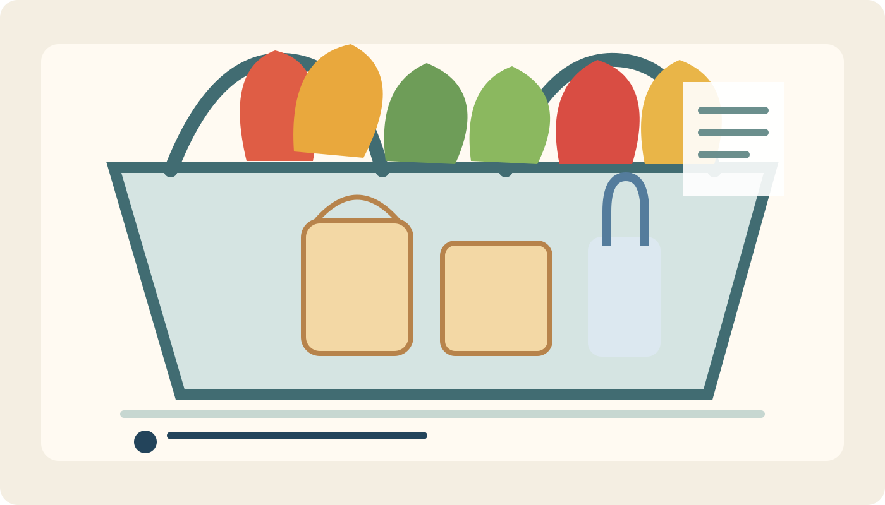

# Cost of Living in Canada: A Complete Guide for Newcomers

Moving to Canada can be exciting, but your financial plan needs to go beyond the amount shown on a rental listing or the salary quoted in a job advertisement. Housing, food, transport, utilities, phone service, insurance, taxes and one-time settlement costs all affect how far your money goes.

There is no single cost of living that applies to everyone. A single person sharing an apartment in a smaller city may spend far less than a family renting a three-bedroom home in Toronto or Vancouver. Your costs also depend on whether you own a car, how often you eat out, your childcare needs and whether you are arriving with furniture.

**Information checked: November 25, 2026.** Prices change and vary by neighbourhood, household size and provider. Figures in this guide are reference points, not quotes or guaranteed budgets. Check current listings and local prices before making financial commitments.

## In this guide

- [What does cost of living actually mean?](#what-does-cost-of-living-actually-mean)
- [Housing: usually the biggest expense](#housing-usually-the-biggest-expense)
- [Groceries and food](#groceries-and-food)
- [Transportation: transit or a car?](#transportation-transit-or-a-car)
- [Utilities, internet and mobile service](#utilities-internet-and-mobile-service)
- [Healthcare, insurance and childcare](#healthcare-insurance-and-childcare)
- [Taxes and take-home pay](#taxes-and-take-home-pay)
- [Example monthly budgets](#example-monthly-budgets)
- [How costs differ by city](#how-costs-differ-by-city)
- [One-time costs when you arrive](#one-time-costs-when-you-arrive)
- [How to reduce your monthly expenses](#how-to-reduce-your-monthly-expenses)
- [Common budgeting mistakes](#common-budgeting-mistakes)
- [Frequently asked questions](#frequently-asked-questions)

## What does cost of living actually mean?

Cost of living is the amount you need to pay for the goods and services required for everyday life in a particular place. For newcomers, it is useful to separate expenses into three groups:

1. **Fixed or recurring essentials:** rent, tenant insurance, phone, internet, transit pass, childcare and debt payments.
2. **Variable essentials:** groceries, electricity, heating, fuel, medication, household supplies and clothing.
3. **Discretionary spending:** restaurants, entertainment, subscriptions, travel and hobbies.

You should also distinguish monthly living costs from arrival costs. A rental deposit, temporary accommodation, winter clothing, furniture and application-related expenses can make the first few months substantially more expensive than a normal month.

For a current snapshot of price movement, Statistics Canada's October 2026 Consumer Price Index rose 3.1% compared with October 2025. Prices for food purchased from stores rose 2.0% year over year and the shelter component rose 1.4%. These figures describe average price changes across the economy; they do not tell you what a specific apartment, grocery basket or household will cost. Your own spending pattern can differ considerably.

Statistics Canada's Survey of Household Spending found that Canadian households spent an average of $76,750 on goods and services in 2023. Shelter represented 32.1% of consumption spending, transportation 15.8%, and food 15.7%. These are national household averages from 2023—not a recommended budget for a newcomer or a current 2026 price list. Household size, income and location make a major difference. [Read Statistics Canada's household spending results](https://www150.statcan.gc.ca/n1/daily-quotidien/250521/dq250521a-eng.htm).

## Housing: usually the biggest expense

Housing is often the expense that determines whether a city is affordable for you. Before choosing a neighbourhood, compare the total cost of the home and the cost of getting to work, school, shops and essential services.

### Understand asking rent versus paid rent

An advertised asking rent is what a landlord is requesting for a unit currently available to rent. Paid rent is what existing tenants are paying under their leases. These are not interchangeable. A person renewing an older lease may pay a different amount from someone moving into a newly advertised apartment.

Statistics Canada's second-quarter 2026 data reported an average asking rent of **$2,130 per month for a two-bedroom apartment across the combined census metropolitan areas**. The highest listed city averages included Vancouver at $3,030, Toronto at $2,650, Victoria at $2,640 and Halifax at $2,400. In Toronto, the average paid rent for a two-bedroom apartment was $2,160, illustrating why asking and paid rent should not be confused. These are averages, not quotes for a particular neighbourhood or property. [See Statistics Canada's Q2 2026 rent statistics](https://www150.statcan.gc.ca/n1/daily-quotidien/260909/dq260909c-eng.pdf).

### Choose the housing arrangement that fits your first year

- **Shared accommodation:** Renting a room can reduce your initial housing bill and may include utilities or furnishings. Confirm who is on the lease, which spaces are shared and what happens if a roommate moves out.
- **Studio or one-bedroom apartment:** Offers privacy but can be expensive in major employment centres.
- **Two-bedroom apartment:** May suit a couple, a small family or roommates splitting costs. Check whether the building charges extra for parking, laundry or amenities.
- **Basement apartment:** Can be less expensive, but inspect natural light, ventilation, heating, moisture, ceiling height, exits and local legal requirements.
- **Living farther from downtown:** Lower rent may be offset by commuting time, transit costs or the need for a car.

Before sending money, view the unit in person or arrange a reliable live viewing, verify the landlord or property manager, read the lease and understand the deposit rules in your province. Be cautious of unusually cheap listings, pressure to pay immediately, requests for gift cards or wire transfers, and people who refuse to show the property.

## Groceries and food

Food spending depends on household size, dietary preferences, cooking habits and where you shop. A person who prepares most meals at home will usually have a different budget from someone who frequently buys lunch near work or orders delivery.

Statistics Canada's 2023 household spending survey reported average annual household food spending of $12,046, including food purchased from stores and restaurants. The figure is a household average, not an individual grocery allowance. [See the survey details](https://www150.statcan.gc.ca/n1/daily-quotidien/250521/dq250521a-eng.htm).

To build a practical food budget:

- Plan meals for a week before shopping.
- Compare unit prices, not just package prices.
- Use store brands for staples when quality is comparable.
- Buy seasonal produce and freeze items you will not use immediately.
- Check flyers and loyalty offers, but do not buy unnecessary products just to earn points.
- Pack lunch and drinks for work or school.
- Track restaurant, coffee and delivery spending separately from groceries.

Newcomers who follow vegetarian, halal, kosher or other specific diets should check the availability and price of familiar ingredients in the neighbourhoods they are considering. Specialty shops can be convenient, while larger supermarkets and warehouse stores may offer better prices on some staples. Do not assume that every city has the same selection.

## Transportation: transit or a car?

Transportation can change your budget dramatically. In a dense city with reliable public transit, a monthly pass may be cheaper than owning a vehicle. In a smaller community or a suburb with limited transit, a car may be necessary for work, childcare or daily errands.

### If you use public transit

Check the transit agency's current adult fare, monthly pass, transfer rules and any employer or student discounts. Also consider whether your home is within a safe, practical walk of a station or bus route. A cheaper apartment that requires multiple transfers may cost you more in time and fares.

### If you own a car

Do not budget only for the monthly loan payment. Include:

- Insurance, which varies by driver, vehicle, postal code and coverage.
- Fuel or electricity.
- Parking at home and work.
- Maintenance, tires and repairs.
- Registration and inspection requirements where applicable.
- Financing interest and depreciation, if you buy the vehicle.

Get an insurance quote before buying a car. A vehicle that appears affordable may be expensive to insure, particularly for a newcomer without a Canadian driving or insurance history. If you have a foreign licence or driving record, ask the provincial licensing authority and insurers what documents they accept.

## Utilities, internet and mobile service

Ask the landlord which utilities are included. Electricity, natural gas, water and heating may be billed separately, depending on the property and province. Older or poorly insulated homes can have higher heating or cooling costs.

For internet and mobile service, compare the total monthly price after promotional periods, equipment rental, activation fees, data limits and cancellation conditions. Check whether the advertised price requires a bundle or a long-term commitment. A newcomer may not need the most expensive phone plan or fastest home internet immediately.

## Healthcare, insurance and childcare

Public health insurance is administered by provinces and territories. Eligibility, coverage start dates and covered services differ. Before arriving, check the rules for the province where you plan to live. Do not assume that every visitor, student, temporary worker or new resident is covered immediately.

Public plans generally do not cover every health-related expense. Prescription drugs outside hospital settings, dental care, vision care, ambulance services and some therapies may require private insurance or out-of-pocket payment, depending on your circumstances and provincial programs.

If there may be a gap before public coverage begins, investigate suitable private medical insurance before travelling. Read exclusions, pre-existing-condition rules, waiting periods, benefit limits and emergency procedures carefully.

Childcare can be a major expense and availability may be limited. Check provincial and territorial childcare systems, licensed-provider directories, subsidies and eligibility for fee-reduction programs. Do not assume that a national fee policy means every family will find a space at the same price.

## Taxes and take-home pay

A salary is not the amount that lands in your bank account. Payroll deductions can include federal and provincial or territorial income tax, Canada Pension Plan contributions and Employment Insurance premiums, depending on your situation. Your net pay depends on income, province, tax credits, benefits and other circumstances.

Use the [Canada Revenue Agency payroll deductions online calculator](https://www.canada.ca/en/revenue-agency/services/e-services/e-services-businesses/payroll-deductions-online-calculator.html) for an estimate. It is a planning tool, not a guarantee of your final tax bill. Also remember that sales taxes differ across provinces and territories. The price displayed on a shelf may not be the final amount at checkout.

When comparing job offers, compare estimated take-home pay and total compensation—not just gross annual salary. Consider benefits, pension contributions, paid leave, commuting costs and whether the job requires you to live in an expensive area.

## Example monthly budgets

Use the table below as a planning worksheet rather than treating it as a national price list. Fill it with quotes for the exact neighbourhood and household you are considering. A realistic budget is built from local prices and your own circumstances—not from a single online estimate.

### Build your own monthly budget

| Budget line | What to enter | Where to verify |
|---|---|---|
| Rent | Actual asking rent for the unit and lease terms | Current listings and a written lease |
| Tenant insurance | Quote for your address and belongings | Licensed insurance provider |
| Electricity and heating | Seasonal estimate and what the landlord includes | Utility provider or previous bills |
| Food and household supplies | Weekly grocery plan multiplied by your monthly shopping pattern | Your own receipts and local store prices |
| Transport | Transit pass or the full cost of a vehicle | Local transit agency; insurer; vehicle budget |
| Phone and internet | Regular price after any promotion expires | Provider contract and plan details |
| Health and dental | Coverage gap, prescriptions and services not covered publicly | Provincial health plan and insurer |
| Childcare | Fees, deposits and subsidy eligibility | Licensed local providers and provincial program |
| Debt and remittances | Required payments and planned family support | Your own statements |
| Emergency savings | A monthly amount you can maintain | Your cash-flow plan |

Add the rows to calculate your expected monthly outflow. Then compare that figure with estimated take-home pay, not gross salary. If the budget only balances when you omit savings, irregular bills or transport, revisit the housing choice or income assumptions before committing.

### Plan for irregular expenses too

Some costs arrive quarterly, annually or unexpectedly. Convert them into a monthly amount so they do not surprise you. Examples include vehicle registration, winter tires, dental work, school supplies, annual memberships, travel to visit family and replacing a laptop or phone. If you have a car, keep a separate repair reserve; if you rent, plan for moving costs and possible rent increases within the legal rules that apply to your province.

The following are **illustrative planning scenarios, not official averages or price quotes**. They are deliberately broad because actual rent, utilities, food, transport and household needs vary widely. Replace each assumption with current local quotes before making a decision.

| Expense | Single person sharing | Couple renting a one-bedroom | Family of four renting a larger home |
|---|---:|---:|---:|
| Housing | Room in shared home | One-bedroom rent | Two- or three-bedroom rent |
| Food | Mostly home-cooked | Mostly home-cooked | Groceries plus school meals |
| Transport | Transit or walking | Transit or one car | Transit or one car |
| Utilities and communications | Share of bills | Household bills | Higher household usage |
| Insurance and health costs | Based on coverage | Based on coverage | Family coverage and needs |
| Childcare | Not applicable | Not applicable | Depends on ages and spaces |
| Other spending | Personal essentials | Household and personal | School, clothing and family needs |

Do not treat a single national number as a safe minimum. Instead, build your own budget with actual listings and quotes. Add a contingency for unexpected costs and try to maintain an emergency fund after paying your initial settlement expenses.

## How costs differ by city

The same salary can produce very different living standards depending on where you live. Housing is a major reason, but transportation, childcare, taxes, utilities and local job opportunities also matter.

| City or region | What to investigate |
|---|---|
| Toronto and Greater Toronto Area | High advertised rents in many neighbourhoods; compare transit access, commute costs and nearby municipalities |
| Vancouver and surrounding communities | High housing costs; compare transit-connected areas and the cost of commuting from outside the city |
| Ottawa | Compare neighbourhood rent, public transit routes and employment location |
| Calgary and Edmonton | Compare housing options with winter transport, insurance and car ownership costs |
| Montréal and Québec City | Review local rent, French-language requirements for work and services, and provincial tax differences |
| Halifax and other Atlantic cities | Check current rental supply and local wages; do not assume a smaller market automatically means low costs |
| Smaller cities and towns | Compare rent with the number of employers, healthcare access, transit and the likelihood you will need a car |

Statistics Canada's rent data shows that advertised rents differ substantially between metropolitan areas. CMHC's 2026 mid-year rental market update also describes how asking rents and vacancy conditions vary by market and by type of unit. [Read CMHC's rental market update](https://www.cmhc-schl.gc.ca/en/observer/2026/2026-mid-year-rental-market-update).

## One-time costs when you arrive

Your first month may include costs that do not repeat every month:

- Temporary accommodation while you find a long-term rental.
- Travel and baggage expenses.
- Rental deposit or other lawful move-in payments.
- Basic furniture, bedding, cookware and household supplies.
- Winter clothing and footwear appropriate for your destination.
- Local transport while you arrange a vehicle or transit pass.
- Documents, translations, credential assessments or licensing fees.
- Childcare deposits or school-related supplies, where relevant.

Keep receipts and a record of payments. Avoid committing all your savings to rent or furniture before you understand your ongoing costs and income.

### Compare the full cost of a move, not rent alone

Before choosing between two cities, estimate the cost of reaching work, school, childcare, grocery stores and healthcare. A lower rent in a car-dependent suburb can be offset by insurance, fuel, parking and vehicle maintenance. Conversely, a more expensive apartment near frequent transit may reduce the need for a second vehicle. Compare commute time as well as dollars: a long journey can affect childcare arrangements, overtime availability and quality of life.

For a fair comparison, use the same household assumptions in each city. Compare the same bedroom count, similar neighbourhood access, the same transport choice and the same food plan. Do not compare a furnished room in one city with an entire apartment in another and call the difference a city-wide cost comparison.

## How to reduce your monthly expenses

1. **Choose the location before choosing the apartment.** Map the commute to likely workplaces and essential services.
2. **Consider shared housing at first.** It can reduce risk while you learn the local rental market.
3. **Delay major purchases.** Furnish gradually and compare used items from reputable sources.
4. **Use transit where practical.** Calculate the full cost of car ownership before deciding.
5. **Cook at home.** Plan meals and monitor food waste.
6. **Compare recurring contracts.** Review phone, internet, insurance and subscription costs every year.
7. **Check eligibility for public programs.** Benefits and subsidies depend on status, income, family circumstances and jurisdiction.
8. **Build an emergency buffer.** A budget that works only when nothing goes wrong is not a safe budget.

## Common budgeting mistakes

- Using an old rent figure from a friend who signed a lease years ago.
- Confusing asking rent with the rent paid by existing tenants.
- Comparing gross salary with monthly expenses.
- Forgetting sales tax, payroll deductions and insurance.
- Buying a car before checking insurance and commuting alternatives.
- Assuming public healthcare covers dental care, prescriptions and every service.
- Underestimating temporary accommodation and furnishing costs.
- Sending deposits before verifying a rental listing and lease.
- Choosing a city only because rent is lower, without checking job availability and transport.

## Frequently asked questions

### Is Canada expensive to live in?

It can be, particularly in housing markets where rent takes a large share of income. But costs differ considerably by city, household size, housing arrangement and lifestyle. Build a local budget rather than relying on a national label.

### Which Canadian city has the lowest cost of living?

There is no single answer that applies to every household. A city with lower rent may have fewer jobs in your field or require a car. Compare housing, wages, transportation, taxes and services together.

### How much money does a newcomer need per month?

There is no universal amount. A single person sharing accommodation has a different budget from a family renting a home. Use current rental listings, grocery costs, transit fares, insurance quotes and your expected take-home income to calculate your own figure.

### Is rent cheaper outside Toronto and Vancouver?

Often, advertised rents are lower in many other markets, but not everywhere and not for every unit type. Check current local data and listings. Consider wages, transport and job availability as well.

### Should I buy a car when I arrive?

Not automatically. In transit-connected areas, public transportation may be more economical. In other locations, a car may be useful or necessary. Get insurance and financing estimates before purchasing.

### Does Canadian public healthcare cover everything?

No. Provincial and territorial plans cover eligible medically necessary services under their rules, but coverage differs and many services may not be included. Confirm coverage with the health ministry where you will live.

### Are groceries cheaper at warehouse stores?

They can be for some products and larger households, but membership fees, package size, transport and food waste matter. Compare unit prices and buy only what you can use.

### How should I budget before I have a Canadian job?

Estimate your essential expenses, confirm your legal ability to work, plan for a realistic job-search period and keep a reserve for unexpected costs. Do not assume you will find work immediately or receive a particular salary.

## Related BG2C guides

If you are still planning your move, start with our [Moving to Canada: A Complete Beginner's Guide](/articles/complete-guide-moving-to-canada/). For an overview of routes to permanent residence, see [Canada's Immigration Pathways Explained](/articles/canada-immigration-pathways/). If employment income is part of your plan, continue with our [guide to finding a job in Canada](/articles/how-to-find-a-job-in-canada/).

## Conclusion: build a budget around your actual life

The cost of living in Canada is not one number. It is the combined cost of your home, food, transport, healthcare needs, family responsibilities and everyday choices in the place where you plan to settle.

Start with housing and transport, because those decisions influence many other expenses. Then compare your likely take-home income with a realistic monthly budget and keep enough savings for one-time and unexpected costs. Recheck local prices before signing a lease or accepting a job.

## Official sources and further reading

- [Statistics Canada — Survey of Household Spending, 2023](https://www150.statcan.gc.ca/n1/daily-quotidien/250521/dq250521a-eng.htm)
- [Statistics Canada — Quarterly rent statistics, Q2 2026](https://www150.statcan.gc.ca/n1/daily-quotidien/260909/dq260909c-eng.pdf)
- [CMHC — 2026 Mid-Year Rental Market Update](https://www.cmhc-schl.gc.ca/en/observer/2026/2026-mid-year-rental-market-update)
- [Statistics Canada — Consumer Price Index, October 2026](https://www150.statcan.gc.ca/n1/daily-quotidien/261116/dq261116a-eng.htm)
- [Canada Revenue Agency — Payroll Deductions Online Calculator](https://www.canada.ca/en/revenue-agency/services/e-services/e-services-businesses/payroll-deductions-online-calculator.html)
- [Government of Canada — Health care in Canada](https://www.canada.ca/en/health-canada/services/canada-health-care-system.html)

