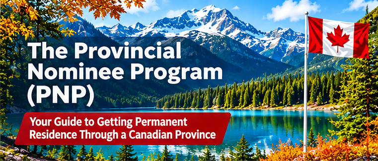
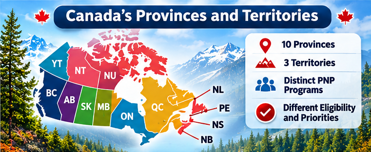

# Provincial Nominee Program (PNP) Canada: A Complete Beginner's Guide

Canada's Provincial Nominee Program (PNP) gives participating provinces and territories a way to nominate people who have the skills, education or work experience they need. For some applicants, a provincial nomination may offer a route to permanent residence that is different from applying through a federal Express Entry program alone.

But PNP is not one national application stream with identical rules everywhere. Each participating province or territory sets its own streams, eligibility criteria, intake limits and selection priorities. Some streams are linked to Express Entry; others use a separate, non-Express Entry process.

This guide explains how the system works, what the two application routes mean, how to research a province and what to watch for before applying. It does not determine whether you qualify for a particular stream.

**Information checked: November 24, 2026.** Provincial streams and intake status can change quickly. Confirm the current rules on both the province or territory's official website and IRCC's federal instructions before making a decision.

*The PNP is a collection of province- and territory-led streams, not one identical program across Canada.*

## In this guide

- [What is the Provincial Nominee Program?](#what-is-the-provincial-nominee-program)
- [Which provinces and territories participate?](#which-provinces-and-territories-participate)
- [How the two PNP routes work](#how-the-two-pnp-routes-work)
  - [Express Entry-aligned PNP](#express-entry-aligned-pnp)
  - [Non-Express Entry PNP](#non-express-entry-pnp)
- [Common types of provincial streams](#common-types-of-provincial-streams)
  - [Skilled workers with a job offer](#skilled-workers-with-a-job-offer)
  - [Skilled workers without a job offer](#skilled-workers-without-a-job-offer)
  - [International graduates](#international-graduates)
  - [In-demand occupations and targeted sectors](#in-demand-occupations-and-targeted-sectors)
  - [Entrepreneur and business streams](#entrepreneur-and-business-streams)
- [Who may be a good fit for PNP?](#who-may-be-a-good-fit-for-pnp)
- [How to research and apply for a nomination](#how-to-research-and-apply-for-a-nomination)
  - [Step 1: Choose a province where you genuinely intend to settle](#step-1-choose-a-province-where-you-genuinely-intend-to-settle)
  - [Step 2: Find the official provincial immigration website](#step-2-find-the-official-provincial-immigration-website)
  - [Step 3: Confirm the stream is open and that you meet its rules](#step-3-confirm-the-stream-is-open-and-that-you-meet-its-rules)
  - [Step 4: Follow the province's selection process](#step-4-follow-the-provinces-selection-process)
  - [Step 5: Review the nomination](#step-5-review-the-nomination)
  - [Step 6: Submit the federal permanent residence application](#step-6-submit-the-federal-permanent-residence-application)
  - [Step 7: Maintain your status and respond to requests](#step-7-maintain-your-status-and-respond-to-requests)
- [Documents you may need](#documents-you-may-need)
- [What happens after nomination?](#what-happens-after-nomination)
- [Important limits and risks](#important-limits-and-risks)
  - [A nomination does not guarantee permanent residence](#a-nomination-does-not-guarantee-permanent-residence)
  - [You must intend to live in the nominating province](#you-must-intend-to-live-in-the-nominating-province)
  - [Streams can pause or change](#streams-can-pause-or-change)
  - [A work permit is separate](#a-work-permit-is-separate)
  - [Quebec is different](#quebec-is-different)
  - [Beware of guaranteed-nomination promises](#beware-of-guaranteed-nomination-promises)
- [Common PNP mistakes](#common-pnp-mistakes)
- [Frequently asked questions](#frequently-asked-questions)
  - [Does every province in Canada have a PNP?](#does-every-province-in-canada-have-a-pnp)
  - [How many CRS points do you get for a provincial nomination?](#how-many-crs-points-do-you-get-for-a-provincial-nomination)
  - [Can I apply for PNP without Express Entry?](#can-i-apply-for-pnp-without-express-entry)
  - [Do I need a job offer for PNP?](#do-i-need-a-job-offer-for-pnp)
  - [Is PNP easier than Express Entry?](#is-pnp-easier-than-express-entry)
  - [Can I move to another province after getting PR through PNP?](#can-i-move-to-another-province-after-getting-pr-through-pnp)
  - [Does a provincial nomination give me a work permit?](#does-a-provincial-nomination-give-me-a-work-permit)
- [Your PNP research checklist](#your-pnp-research-checklist)
- [Official sources](#official-sources)

---

## What is the Provincial Nominee Program?

The PNP allows participating provinces and territories to nominate people who:

- Have skills, education or work experience that may support the region's economy.
- Intend to live in the province or territory that nominates them.
- Want to become permanent residents of Canada.
- Meet the requirements of the specific provincial or territorial stream and the federal permanent residence process.

The federal government remains responsible for the final permanent residence decision. A provincial nomination is an important selection step, but it is not the same as becoming a permanent resident. Applicants must still satisfy applicable federal requirements, including admissibility and document checks.

A useful way to understand the system is to think of it as two levels:

1. **Provincial or territorial selection:** The province or territory decides whether to nominate you under one of its streams.
2. **Federal permanent residence processing:** IRCC assesses your permanent residence application under the applicable federal process.

The province does not simply hand out PR status. It nominates candidates, while IRCC makes the federal decision.

Official overview: [IRCC — Immigrate as a provincial nominee](https://www.canada.ca/en/immigration-refugees-citizenship/services/immigrate-canada/provincial-nominees.html).

## Which provinces and territories participate?

Most provinces and territories operate PNP streams, but the arrangements are not identical across Canada.

| Province or territory | PNP status |
|---|---|
| Alberta | Has provincial nominee streams |
| British Columbia | Has provincial nominee streams |
| Manitoba | Has provincial nominee streams |
| New Brunswick | Has provincial nominee streams |
| Newfoundland and Labrador | Has provincial nominee streams |
| Nova Scotia | Has provincial nominee streams |
| Ontario | Has provincial nominee streams |
| Prince Edward Island | Has provincial nominee streams |
| Saskatchewan | Has provincial nominee streams |
| Yukon | Has territorial nominee streams |
| Northwest Territories | Has territorial nominee streams |
| Quebec | Does not participate in the PNP; it has its own selection programs |
| Nunavut | Does not have a PNP |

*Quebec uses its own economic selection system, while Nunavut does not have a PNP. Always verify current stream details with the relevant jurisdiction.*

IRCC's current PNP page links to the participating jurisdictions' program websites. Use those official pages to check streams and current intake. Do not rely on an old blog post that lists a stream as open; a province can pause, change, cap or close an intake.

If your genuine intention is to settle in Quebec, research Quebec's own immigration selection process. If you want to settle in Nunavut, use the territorial and federal routes that apply there rather than searching for a Nunavut PNP stream.

Official source: [IRCC — Provincial and territorial nominee program links](https://www.canada.ca/en/immigration-refugees-citizenship/services/immigrate-canada/provincial-nominees.html).

## How the two PNP routes work

There are two federal application routes for provincial nominees. Which one applies depends on the provincial stream and whether you also qualify for an eligible Express Entry program.

### Express Entry-aligned PNP

An Express Entry-aligned stream is sometimes called an enhanced PNP stream. It is for applicants who qualify for the provincial stream and for one of the federal programs managed through Express Entry.

The general process is:

1. Check whether you meet the requirements of an Express Entry program.
2. Check the provincial stream's requirements and whether it is linked to Express Entry.
3. Follow the province's instructions to apply for a nomination or indicate interest, depending on the stream.
4. If the province nominates you, accept or confirm the nomination through your Express Entry profile when instructed.
5. A valid Express Entry-linked provincial nomination adds 600 CRS points.
6. If you receive an invitation to apply, submit the federal permanent residence application within the stated deadline and provide the required documents.

The 600 points can significantly improve a candidate's ranking in the Express Entry pool. However, a nomination is not automatic, and the points are not awarded simply because you live in a province, have a job there or create an Express Entry profile. You need a valid nomination through an eligible Express Entry-aligned stream and must follow the confirmation process.

Official sources: [IRCC — PNP through Express Entry](https://www.canada.ca/en/immigration-refugees-citizenship/services/immigrate-canada/provincial-nominees/express-entry.html) and [who can apply](https://www.canada.ca/en/immigration-refugees-citizenship/services/immigrate-canada/provincial-nominees/express-entry/eligibility.html).

### Non-Express Entry PNP

A non-Express Entry stream, sometimes called a base PNP stream, is for applicants who qualify for a provincial or territorial stream but do not apply through an Express Entry-aligned route.

The general process is:

1. Check the province's non-Express Entry stream requirements.
2. Submit a provincial nomination application using the province's instructions.
3. If nominated, follow IRCC's current non-Express Entry permanent residence application instructions.
4. Submit the required federal forms and supporting documents.
5. Complete any requested biometrics, medical, police and other checks.
6. Wait for IRCC's decision.

A non-Express Entry nomination does not add 600 CRS points to an Express Entry profile because this is a separate application route. The provincial nomination is used in the non-Express Entry permanent residence process instead.

Do not assume that you can choose whichever route seems faster. The province's stream determines the route, and you must meet the requirements that apply to it.

Official source: [IRCC — Apply for permanent residence as a provincial nominee](https://www.canada.ca/en/immigration-refugees-citizenship/services/immigrate-canada/provincial-nominees.html).

## Common types of provincial streams

Stream names and rules differ, but many programs are designed around recurring applicant profiles.

### Skilled workers with a job offer

Some streams require a qualifying offer from an employer in the province. Rules may cover the employer, occupation, wage, duties, work location and the candidate's experience and language ability. A job offer alone is not a nomination.

### Skilled workers without a job offer

Some streams select candidates without a job offer, often through an expression-of-interest system or the Express Entry pool. Selection may depend on occupation, education, language ability, work experience or ties to the province. Minimum eligibility does not guarantee selection.

### International graduates

Graduate streams may require a credential from an eligible institution or program, and may also require a job offer, work experience or a connection to the province. Graduation in Canada does not automatically create eligibility for a nomination or a post-graduation work permit.

### In-demand occupations and targeted sectors

A province may prioritize occupations or sectors based on labour-market needs. Where a stream uses the National Occupational Classification (NOC), actual job duties matter; a job title alone is not enough.

### Entrepreneur and business streams

Some jurisdictions have streams for people who will establish or actively manage a business. Requirements can include business experience, net worth, investment, a business plan and performance commitments. These are not passive-investment shortcuts. Review the current provincial rules and obtain professional advice before transferring funds or signing a purchase agreement.
## Who may be a good fit for PNP?

PNP may be worth researching if:

- Your occupation, work history or education matches a province's current priorities.
- You have a genuine job offer from an employer that meets the stream's rules.
- You studied or worked in a province and meet a graduate or local-experience stream's requirements.
- You have a genuine intention and practical ability to settle in the nominating province.
- You qualify for an Express Entry-linked stream and want to be considered through that provincial route.
- You have a business background and meet the requirements of a specific entrepreneur stream.

PNP may not be the right starting point if you have not decided where you genuinely want to live, you are relying on a job offer that has not been verified, or you have not checked whether the stream is open. In those situations, start with the official program directories and compare more than one pathway.

For a broad comparison of all major PR options, see BG2C's [Canada immigration pathways guide](/articles/canada-immigration-pathways/). If you are also considering Express Entry, read our [Express Entry beginner's guide](/articles/complete-beginners-guide-express-entry-canada/).

## How to research and apply for a nomination

There is no single PNP application form. The correct steps depend on the province and stream.

### Step 1: Choose a province where you genuinely intend to settle

Compare employment opportunities, the occupation you want to pursue, family connections, language, cost of living and the practical realities of living there. Do not choose a province only because a stream appears easier if you have no intention of settling there.

### Step 2: Find the official provincial immigration website

Start with IRCC's PNP directory and follow the link to the province or territory. Read the stream page, program guide, intake status, employer requirements and document checklist. Social-media summaries can be outdated.

### Step 3: Confirm the stream is open and that you meet its rules

Check whether the stream is accepting applications, expressions of interest or invitations. Confirm whether it needs a job offer, an approved employer, a particular occupation, language results, education, local work or study, an Express Entry profile, settlement funds or an intention to live in the province.

Read the full program guide. A short eligibility quiz does not replace the official rules.

### Step 4: Follow the province's selection process

Depending on the stream, you may need to submit an expression of interest, register a profile, receive an invitation, apply directly or be selected from the Express Entry pool. Some streams are employer-driven. Do not confuse registration with a nomination application.

### Step 5: Review the nomination

If nominated, check the certificate and instructions, including your name, stream, validity period and conditions. For an Express Entry-linked nomination, follow IRCC's instructions to accept or confirm it in your profile. For a non-Express Entry nomination, use the separate federal instructions.

### Step 6: Submit the federal permanent residence application

A nomination is not final PR approval. Submit the correct federal application with complete forms, fees and supporting documents before the applicable deadline. Keep copies of the nomination, application and payment records.

### Step 7: Maintain your status and respond to requests

If you are in Canada, continue to obey your temporary status conditions. A nomination does not automatically extend a work permit or authorize employment. Respond to IRCC requests by the deadline.
## Documents you may need

The exact checklist depends on the stream and your circumstances. Documents may include:

- Passport and identity documents.
- Language test results, if required.
- Education certificates, transcripts and an Educational Credential Assessment, if required.
- Employment reference letters showing duties, dates, hours and pay.
- Pay statements, tax records or other evidence of work history.
- Job offer and employer documents, where required.
- Proof of provincial study or work experience, where relevant.
- Proof of settlement funds, if required.
- Civil-status documents for accompanying family members.
- Police certificates, medical examinations and biometrics when requested or required.

A job reference letter should accurately describe the work performed. A job title by itself may not establish that the experience matches a particular NOC or stream. Never alter duties or dates to fit an immigration category.

Use the checklist for your exact provincial stream and the federal PR process. Uploading a large collection of unrelated documents does not replace the evidence the program actually asks for.

## What happens after nomination?

The next steps depend on the route:

| Stage | Express Entry-aligned PNP | Non-Express Entry PNP |
|---|---|---|
| Provincial selection | Apply under an aligned stream and receive nomination | Apply under a base stream and receive nomination |
| Federal route | Nomination is confirmed in Express Entry profile | Apply through the non-Express Entry PR process |
| CRS points | A valid nomination adds 600 CRS points | No 600-point addition through this route |
| Invitation | You still need an invitation to apply through Express Entry | No Express Entry invitation is used for the base route |
| Final decision | IRCC assesses the PR application | IRCC assesses the PR application |

IRCC may request biometrics, medical examinations, police certificates, updated forms or additional evidence. Processing times depend on the stream, application type, completeness, verification needs and available admissions spaces. Do not rely on a processing-time figure from an old article or an agent's estimate.

## Important limits and risks

### A nomination does not guarantee permanent residence

The province's nomination is one stage. IRCC makes the federal decision and checks admissibility and application requirements. Incomplete or inaccurate information can cause delays or refusal.

### You must intend to live in the nominating province

PNP supports the jurisdiction that nominates you. Your intention should be genuine. If your circumstances change, review the relevant rules and obtain advice rather than assuming the commitment can be ignored.

### Streams can pause or change

Provinces may change criteria, stop accepting applications, issue targeted invitations or reach an intake cap. Federal admission levels also affect the system. Recheck the provincial page before applying.

### A work permit is separate

A nomination certificate is not a work permit. You need separate authorization to work while waiting for PR. Do not keep working after your authorization expires unless you have legal permission.

### Quebec is different

Quebec selects economic immigrants through its own programs. Nunavut does not have a PNP. Do not assume the same process applies across Canada.

### Beware of guaranteed-nomination promises

No recruiter, employer or consultant can guarantee a nomination or PR approval. Be cautious of anyone selling a job offer, claiming control over a draw or asking you to misrepresent your duties or settlement intentions. Check that paid representatives are authorized.
## Common PNP mistakes

1. **Applying to a stream without reading the current guide.** The stream name may sound suitable, but a key condition such as a job offer, work experience or language result may be missing.
2. **Assuming every province uses the same criteria.** Provincial programs are different and change independently.
3. **Confusing an expression of interest with a nomination.** A profile or registration may only put you into a selection pool.
4. **Assuming a job offer is enough.** The employer, position, wage, duties and location may all have to meet specific rules.
5. **Choosing a province only because a stream appears easier.** PNP candidates must have a genuine intention to settle in the nominating jurisdiction.
6. **Treating 600 CRS points as automatic.** The points apply to a valid Express Entry-aligned nomination after the required confirmation.
7. **Forgetting federal requirements.** A nomination does not remove the need to submit a complete federal PR application and meet admissibility rules.
8. **Using outdated information.** A stream that was open last year may be paused, capped or redesigned today.

## Frequently asked questions

### Does every province in Canada have a PNP?

No. Most provinces and some territories operate nominee programs. Quebec has its own selection system, and Nunavut does not have a PNP. Check IRCC's current directory.

### How many CRS points do you get for a provincial nomination?

A valid nomination through an Express Entry-aligned stream adds 600 CRS points. A non-Express Entry nomination follows a separate process and does not add those points to an Express Entry profile.

### Can I apply for PNP without Express Entry?

Yes. Some streams use a non-Express Entry route. You must meet the provincial stream's requirements and then follow IRCC's federal instructions.

### Do I need a job offer for PNP?

Not always. Some streams require one; others may select candidates based on occupation, education, work experience, language ability, local study or work history, or an Express Entry profile.

### Is PNP easier than Express Entry?

Not automatically. A provincial stream may suit someone whose skills match regional priorities, while another applicant may fit a federal Express Entry program better. Compare the actual requirements and intake status.

### Can I move to another province after getting PR through PNP?

Permanent residents have mobility rights under Canada's Constitution. However, PNP applicants must have a genuine intention to settle in the nominating jurisdiction when applying. A later move for legitimate reasons is different from misrepresenting your intention from the start.

### Does a provincial nomination give me a work permit?

No. A nomination is not work authorization. You need a separate valid work permit or another legal authorization to work in Canada.
## Your PNP research checklist

Before paying a fee or submitting an application, make sure you can answer:

- Which province or territory do I genuinely intend to live in?
- What is the exact name of the PNP stream?
- Is the stream open, and is it accepting applications or expressions of interest?
- Do I need a job offer, and does the employer meet the program's requirements?
- Does my actual work experience match the stream's occupation and duty rules?
- Do I meet education and language requirements?
- Is this stream Express Entry-aligned or non-Express Entry?
- What documents and funds are required?
- What is the nomination certificate's validity period and what must I do next?
- Have I checked the current federal PR instructions and my temporary status obligations?

## Official sources

- [IRCC — Immigrate as a provincial nominee](https://www.canada.ca/en/immigration-refugees-citizenship/services/immigrate-canada/provincial-nominees.html)
- [IRCC — PNP through Express Entry](https://www.canada.ca/en/immigration-refugees-citizenship/services/immigrate-canada/provincial-nominees/express-entry.html)
- [IRCC — PNP Express Entry eligibility](https://www.canada.ca/en/immigration-refugees-citizenship/services/immigrate-canada/provincial-nominees/express-entry/eligibility.html)
- [IRCC — 2027–2029 Immigration Levels Plan](https://www.canada.ca/en/immigration-refugees-citizenship/corporate/immigration-system/levels/supplementary-immigration-levels-2027-2029.html)
- [IRCC — Express Entry](https://www.canada.ca/en/immigration-refugees-citizenship/services/immigrate-canada/express-entry.html)
- [IRCC — Explore immigration programs](https://ircc.canada.ca/explore-programs/)
- [Government of Quebec — Immigration](https://www.quebec.ca/en/immigration)

---
